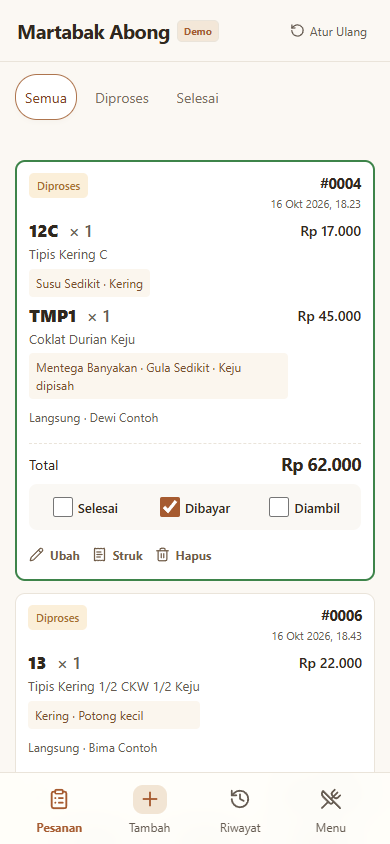
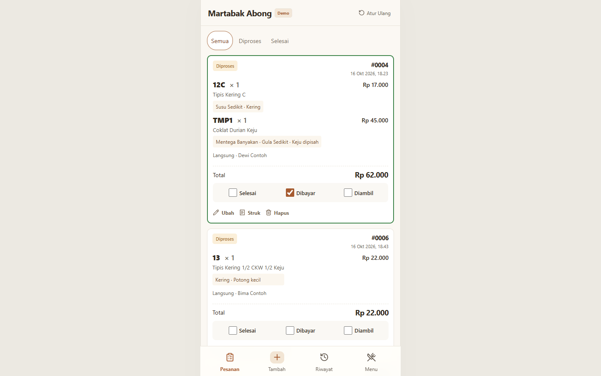

# Martabak Abong — Public Portfolio Demo

A public, interactive demo of the Martabak Abong order management system. Visitors can explore the application immediately without a login, database, account, or environment variables. The Indonesian interface preserves the existing mobile-first design, centered at a maximum width of 480 px on desktop.

**Live demo:** `<ADD_VERCEL_DEMO_URL_AFTER_DEPLOYMENT>`

All sample orders and customer names are fictional. This application is separate from the production system. Changes are stored only in `localStorage` for the current browser and origin; they are never synchronized or sent to a business server. Do not enter real personal information into the public demo.

## Features

- All 15 permanent menu items and their original catalog prices, with editable names, prices, toppings, and availability; temporary menu items support custom names and prices.
- Multiple martabak per order, quantities, dynamic C/K/W codes and names, Campur (menus 2, 7, and 13), Pandan, Kering, notes, and four levels of Mentega, Susu, and Gula.
- Optional customer information; create, edit, delete, and restore orders.
- Selesai (finished), Dibayar (paid), and Diambil (collected) statuses. Finished orders move to the bottom with reduced opacity; Diambil automatically marks an order as Dibayar.
- Daily numbering starts at #0001 at midnight in Asia/Jakarta. Deleted order numbers are never reused.
- Order history, search, date filters, pagination, and five daily/monthly sales statistics based on collected orders.
- CSV export of all matching history records, printable 58/80 mm receipts, and PNG downloads. Receipts and CSV exports exclude customer information.
- Fictional data covering the previous three months, with changes preserved after refresh. The **Atur Ulang** action in the header restores sample orders and the catalog.

## Technology and storage

Next.js 16 App Router, React 19, TypeScript, Zod, Lucide, CSS, Canvas, and `localStorage`. There are no API routes, authentication services, session cookies, middleware/proxy, ORMs, or database drivers.

`src/lib/store.ts` centralizes validation and domain rules. `src/lib/client.ts` connects components to browser storage and downloads. `src/lib/seed.ts` generates fictional data on the first visit and reset, using Western Indonesian Time (WIB). Existing orders retain name and price snapshots after catalog changes. Web Locks serialize operations across tabs in supporting browsers; version checks reject stale edits.

Storage key: `martabak-abong-public:v1`. Clearing site data also clears demo changes. Blocked or full storage and corrupted data produce visible errors; the application does not silently discard stored data. Use Atur Ulang to recover corrupted demo data. Visitors can edit their own browser data, so it is not an authoritative business record.

Order editing and receipts use `/pesanan/?id=...` and `/struk/?id=...`, allowing visitor-created orders to survive direct navigation and refresh on static hosting.

## Language conventions

Documentation, comments, developer messages, and general-purpose code identifiers use English. Keep Indonesian where it represents the application's language: interface labels, user-facing messages, menu names, sample order content, route names, and existing domain terms such as `mentega`, `susu`, `gula`, `campur`, `pandan`, and `kering`. Tests retain Indonesian selectors and expected text when matching the interface. Preserve existing storage keys and values to keep saved browser data compatible.

## Screenshots

Captured from the static production build using fictional data during browser testing.

| Mobile order queue | Monthly sales statistics |
| --- | --- |
|  |  |



## Local development

Use Node.js 24 LTS and npm.

```sh
npm ci
npm run dev
```

Open the [local application](http://localhost:3000). No `.env` file or database setup is required.

To preview the static production output:

```sh
npm run build
npm start
```

`npm start` serves the `out/` directory through a local file server, without application endpoints. The exported files can also be served by other static hosting providers.

## Testing

```sh
npm test
npm run typecheck
npm run build
npm run security:scan
```

Domain tests use in-memory storage with the same rules as `localStorage`, without a database. The security scanner checks source files and exported assets for credential patterns. When `.git` metadata is present, it also checks tracked content and history. Heuristic scanning cannot guarantee that every form of secret is detected.

For browser tests, run `npm start` in one terminal. In a second terminal:

```sh
npx playwright install chromium
npm run test:browser
```

On Windows, you can use an existing Microsoft Edge installation instead:

```powershell
$env:DEMO_BROWSER_CHANNEL = 'msedge'
npm run test:browser
```

`DEMO_URL` overrides the preview address. These are local testing options, not deployment requirements. Browser tests cover order and menu management, statuses, persistence, reset, statistics, CSV/PNG downloads, printing, 320/390/1440 px viewports, and network requests. They update the documentation screenshots and write a summary to the Git-ignored `test-results/` directory. Automated tests replace the system print dialog; physical printing requires a check on an actual printer.

## Vercel deployment

1. Use a dedicated repository containing only this **martabak-abong-public** folder, with Git history separate from production. Run the security scan before uploading it.
2. Import the demo repository as a **new** Vercel project, selecting **Other** as the Framework Preset and Node.js 24. The application is built with Next.js but deployed as exported static files; `"framework": null` in `vercel.json` selects this preset.
3. Use `npm ci` for installation, `npm run build` for the build, and `out` as the output directory (already configured in `vercel.json`).
4. Do not add environment variables, database integrations, or production configuration. There are no migrations or login setup steps.
5. Deploy from the dashboard when ready, check the published site, and replace the live demo URL placeholder above.

The `output: 'export'` configuration produces static HTML/CSS/JS. Vercel security headers are defined in `vercel.json`; apply equivalent headers when using another hosting provider. The Content Security Policy allows the inline scripts required by the static Next.js bootstrap, restricts connections to the same origin, and prevents embedding. No automatic push or deployment was performed while preparing this demo.

### Fixing an existing deployment

If deployment fails with `out/routes-manifest.json` missing, the Next.js framework preset is treating the static export folder as its internal build directory. Use **Other** as the Framework Preset, keep the build command as `npm run build`, and keep the output directory as `out`. The committed `vercel.json` selects these settings and overrides the corresponding dashboard settings, as described in [Vercel's configuration reference](https://vercel.com/docs/project-configuration/vercel-json#framework).

Commit and push the corrected configuration when ready, then deploy that new commit. Redeploying the old failed commit will use its old configuration. No database or environment variables are needed.

See the [verification record](VERIFICATION.md) for completed checks and their limitations.
