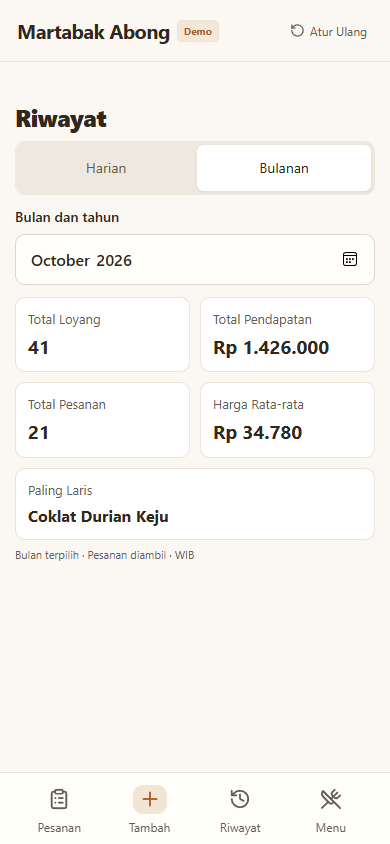

# Martabak Abong — Public Portfolio Demo

Demo publik sistem pengelolaan pesanan Martabak Abong. Pengunjung dapat langsung mencoba aplikasi tanpa login, database, akun, atau variabel lingkungan. Antarmuka Bahasa Indonesia mempertahankan desain mobile dengan lebar maksimal 480 px di desktop.

**Demo langsung:** `<ISI_URL_DEMO_VERCEL_SETELAH_DEPLOY>`

Semua pesanan dan nama pelanggan contoh dibuat secara fiktif. Aplikasi ini terpisah dari sistem produksi. Perubahan hanya disimpan di `localStorage` pada peramban dan origin yang digunakan; tidak ada sinkronisasi atau pengiriman data ke server bisnis. Jangan masukkan informasi pribadi sungguhan ke demo publik.

## Fitur

- 15 menu permanen dengan harga asli katalog, pengaturan nama/harga/topping/ketersediaan, serta menu sementara dengan nama dan harga sendiri.
- Beberapa martabak per pesanan, jumlah, kode/nama C/K/W dinamis, Campur (menu 2, 7, 13), Pandan, Kering, catatan, dan empat tingkat Mentega/Susu/Gula.
- Informasi pelanggan opsional; tambah, ubah, hapus, dan pulihkan pesanan.
- Status Selesai, Dibayar, dan Diambil; pesanan selesai berada di bawah dengan tampilan redup; Diambil otomatis Dibayar.
- Nomor harian mulai #0001 pada pergantian hari Asia/Jakarta. Penghapusan tidak memakai ulang nomor lama.
- Riwayat, pencarian, filter tanggal, paginasi, dan lima statistik harian/bulanan berdasarkan pesanan yang diambil.
- Ekspor CSV seluruh hasil filter, struk cetak 58/80 mm, dan unduhan PNG. Struk dan CSV tidak memuat informasi pelanggan.
- Data fiktif tiga bulan terakhir, tersimpan setelah refresh. Tombol **Atur Ulang** di header memulihkan data contoh dan katalog.

## Teknologi dan penyimpanan

Next.js 16 App Router, React 19, TypeScript, Zod, Lucide, CSS, Canvas, dan `localStorage`. Tidak ada route API, autentikasi, cookie sesi, middleware/proxy, ORM, atau driver database.

`src/lib/store.ts` memusatkan validasi dan aturan data. `src/lib/client.ts` menghubungkan komponen dengan penyimpanan browser dan unduhan. `src/lib/seed.ts` menghasilkan data fiktif saat kunjungan pertama/reset berdasarkan waktu WIB. Menu dan harga pada pesanan lama tetap berupa snapshot meskipun katalog diubah. Web Locks mengurutkan operasi antar-tab pada browser yang mendukungnya; nomor versi menolak perubahan editor yang sudah tertinggal.

Kunci penyimpanan: `martabak-abong-public:v1`. Menghapus data situs juga menghapus perubahan demo. Penyimpanan yang diblokir/penuh atau data yang rusak menampilkan pesan kesalahan; aplikasi tidak diam-diam menghapusnya. Gunakan Atur Ulang untuk memulihkan data rusak. Data browser dapat diedit oleh pengunjung dan bukan sumber catatan bisnis resmi.

Halaman ubah pesanan dan struk memakai `/pesanan/?id=...` dan `/struk/?id=...`, sehingga refresh pada pesanan buatan pengunjung tetap berfungsi di hosting statis.

## Tangkapan layar

Diambil dari hasil build statis dengan data fiktif oleh pengujian browser.

| Pesanan di ponsel | Statistik bulanan |
| --- | --- |
|  |  |


## Menjalankan secara lokal

Gunakan Node.js 24 LTS dan npm.

```sh
npm ci
npm run dev
```

Buka [aplikasi lokal](http://localhost:3000). Tidak perlu membuat `.env` atau menjalankan setup database.

Untuk mencoba keluaran produksi statis:

```sh
npm run build
npm start
```

`npm start` menyajikan folder `out/` melalui server file lokal, tanpa endpoint aplikasi. Hasil ekspor juga dapat disajikan oleh hosting statis lain.

## Pengujian

```sh
npm test
npm run typecheck
npm run build
npm run security:scan
```

Tes domain menggunakan penyimpanan dalam memori dengan aturan yang sama seperti `localStorage`, tanpa database. Pemindaian memeriksa pola kredensial pada sumber dan hasil ekspor; jika folder mempunyai `.git`, konten terlacak dan riwayat juga diperiksa. Pemindaian heuristik tidak menjamin seluruh bentuk rahasia terdeteksi.

Untuk pengujian browser, jalankan `npm start` pada terminal pertama. Pada terminal kedua:

```sh
npx playwright install chromium
npm run test:browser
```

Alternatif Windows dengan Microsoft Edge yang sudah terpasang:

```powershell
$env:DEMO_BROWSER_CHANNEL = 'msedge'
npm run test:browser
```

`DEMO_URL` dapat mengganti alamat preview. Ini hanya opsi pengujian lokal, bukan kebutuhan deployment. Tes browser memeriksa alur CRUD, menu, status, persistensi, reset, statistik, unduhan CSV/PNG, jalur cetak, ukuran 320/390/1440 px, dan permintaan jaringan. Tes tersebut memperbarui tangkapan layar dokumentasi dan menulis ringkasan di `test-results/` yang diabaikan Git. Dialog cetak sistem digantikan saat tes otomatis; cetak fisik memerlukan pemeriksaan pada perangkat printer.

## Deployment Vercel

1. Buat repository baru khusus folder **martabak-abong-public** ini. Folder duplikat ini tidak membawa metadata Git produksi. Jalankan pemindaian keamanan sebelum mengunggah.
2. Import repository demo sebagai project Vercel **baru**, lalu pilih framework Next.js dan Node.js 24.
3. Gunakan perintah instalasi `npm ci`, build `npm run build`, dan output directory `out` (sudah diatur dalam `vercel.json`).
4. Jangan tambahkan variabel lingkungan, integrasi database, atau konfigurasi produksi. Tidak ada migrasi atau setup login.
5. Deploy dari dashboard saat siap, periksa hasilnya, lalu isi placeholder URL demo di atas.

Konfigurasi `output: 'export'` menghasilkan HTML/CSS/JS statis. Header keamanan untuk Vercel ada di `vercel.json`; bila memakai hosting lain, terapkan header serupa di penyedia hosting. CSP mengizinkan skrip inline yang diperlukan bootstrap Next.js statis, membatasi koneksi ke origin sendiri, dan memblokir embedding. Tidak ada proses push atau deployment otomatis dalam pengerjaan demo ini.

Lihat [hasil verifikasi](VERIFICATION.md) untuk pemeriksaan yang telah dijalankan dan batasannya.
